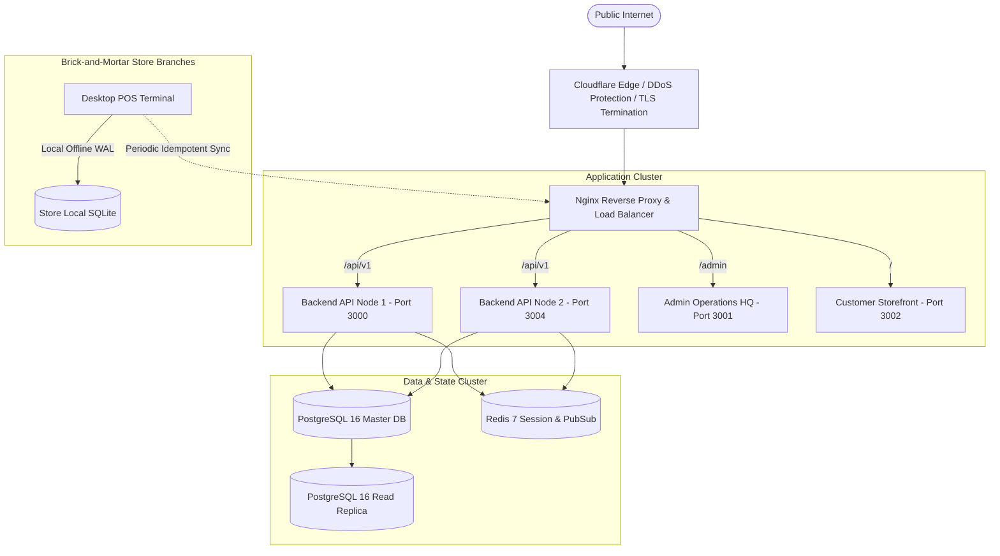

# CYBORG SUPERMARKET — PRODUCTION DEPLOYMENT GUIDE

**Document ID:** DEP-CYB-2026-V1  
**Scope:** Production Topology, Docker Containerization, Reverse Proxy, Mobile/Desktop Distribution, TLS, Backups, and Rollback Strategies  

---

## 1. Production Architecture Topology



---

## 2. Docker Compose Deployment

The repository includes a ready-to-run multi-container definition in `docker-compose.yml`:

```bash
# Start all production infrastructure
docker compose up -d

# Verify container health
docker compose ps
```

Services:
- `backend`: Node.js REST API with health check on `/health`
- `admin-web`: Operations admin dashboard
- `customer-web`: Bilingual storefront
- `db`: PostgreSQL 16 Alpine
- `redis`: Redis 7 Alpine
- `prometheus` & `grafana`: Metrics and system telemetry

---

## 3. Environment Configuration (.env.example)

Ensure the following variables are populated in your production secrets manager:

```ini
# Application Environment
NODE_ENV=production
APP_PORT=3000
API_PREFIX=/api/v1

# Security & Tokens
JWT_SECRET=production_super_secret_key_change_me_before_deploy
JWT_EXPIRATION=86400

# Payment Gateways
PAYMENT_ENV=production
PAYMENT_WEBHOOK_SECRET=prod_whsec_fawry_paymob_secure_key

# Database Connection
DB_DIALECT=sqlite
DB_PATH=/var/data/cyborg_supermarket.db

# Backup Schedule
BACKUP_SCHEDULE_CRON="0 2 * * *"
BACKUP_RETENTION_DAYS=30
```

---

## 4. Reverse Proxy & TLS Configuration (Nginx)

Example production configuration snippet:

```nginx
server {
    listen 443 ssl http2;
    server_name api.cyborg.eg;

    ssl_certificate /etc/letsencrypt/live/api.cyborg.eg/fullchain.pem;
    ssl_certificate_key /etc/letsencrypt/live/api.cyborg.eg/privkey.pem;
    ssl_protocols TLSv1.2 TLSv1.3;

    location / {
        proxy_pass http://127.0.0.1:3000;
        proxy_set_header Host $host;
        proxy_set_header X-Real-IP $remote_addr;
        proxy_set_header X-Forwarded-For $proxy_add_x_forwarded_for;
        proxy_set_header X-Forwarded-Proto $scheme;
    }
}
```

---

## 5. Mobile & Desktop Application Distribution

### Windows Desktop POS Distribution
1. Build release binary:
   ```powershell
   cd desktop-application\pos-application
   flutter build windows --release
   ```
2. The output executable is located at `build/windows/runner/Release/`.
3. Package using Inno Setup or MSIX packager.
4. **Data Preservation:** The installer must preserve `%APPDATA%\CyborgSupermarket\pos_local.db` across updates so cashier shift history and pending offline sync queues are never destroyed.

### Android Application Distribution
1. Configure release keystore:
   ```properties
   storeFile=/path/to/upload-keystore.jks
   storePassword=secure_keystore_password
   keyAlias=cyborg_upload_key
   keyPassword=secure_key_password
   ```
2. Build App Bundle:
   ```bash
   cd mobile-application
   flutter build appbundle --release
   ```
3. Upload `build/app/outputs/bundle/release/app-release.aab` to Google Play Console.

---

## 6. Backup, Recovery & Rollback Strategy

### Automated Backup Routine
- SQLite online backup runs every 6 hours via `node -e "require('./apps/backend/src/modules/backup/backup.service').backupService.createBackup('scheduled')"`
- Backups are stored in `data/backups/` and pruned to retain the last 20 snapshots.

### Rollback Procedure
If a production deployment introduces critical defects:
1. Revert container image tag to previous stable commit.
2. If database schema was migrated, run the corresponding rollback script from `database/migrations/`.
3. If data was corrupted, restore from latest snapshot using `backupService.verifyRestore(snapshotPath)`.
4. Run master test suite (`node scripts/run-all-tests.js`) against the restored instance before switching traffic back.

---

## 7. Commercial Production Readiness Statement

**Notice:** While all 71 automated tests across 9 suites pass and the codebase is architecturally complete, actual commercial go-live requires external legal and enterprise dependencies:
- Commercial merchant account contracts with Fawry / Paymob.
- Egyptian Tax Authority (ETA) USB HSM cryptographic tokens for POS e-Receipt signing.
- Registered corporate domain and SSL certificates.
- Physical Honeywell / Epson POS hardware peripherals for branch checkout lanes.
