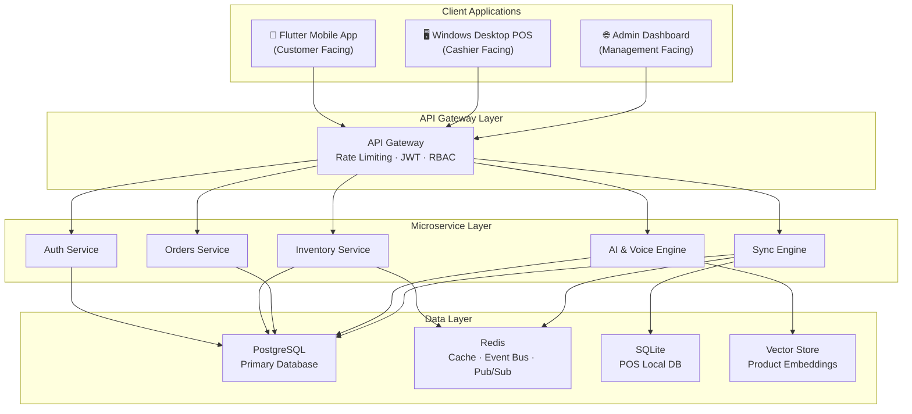
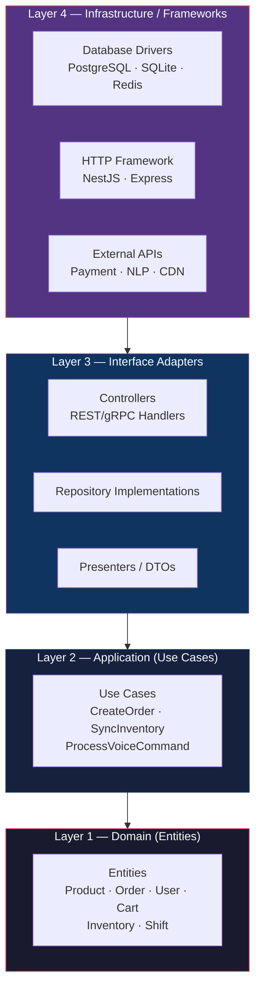
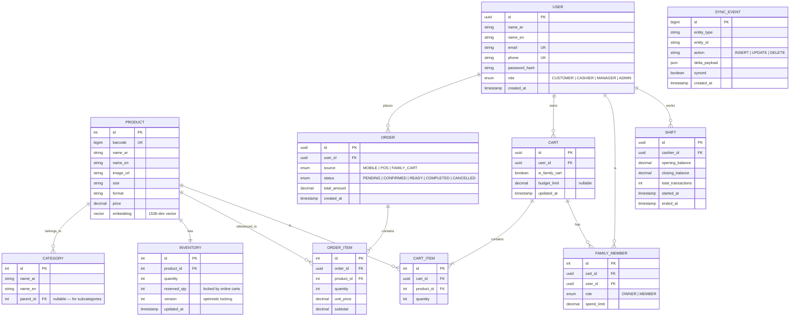
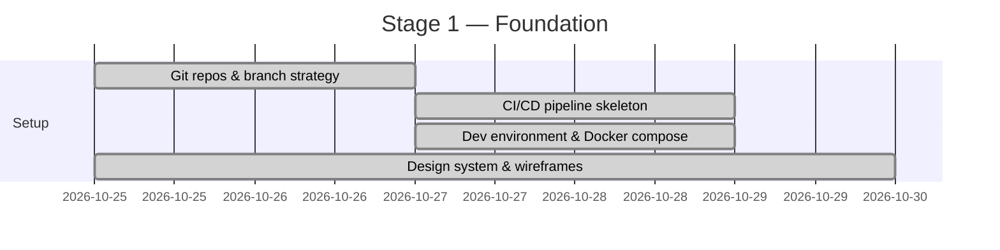
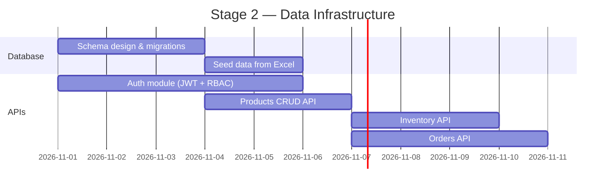
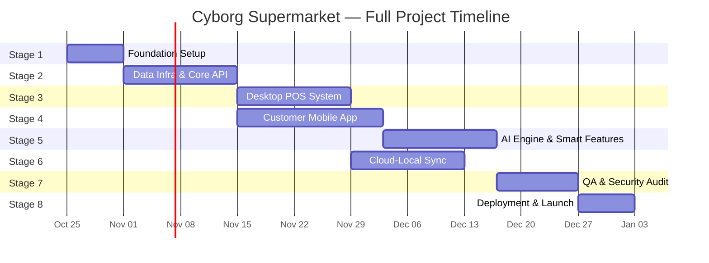

# 🏗️ Cyborg Supermarket — System Architecture & Implementation Blueprint

---

## 1. System Overview

Cyborg is an **omni-channel Egyptian supermarket ecosystem** consisting of three interconnected platforms, a shared backend, and an AI intelligence layer — all synchronized in real-time.



---

## 2. Design Pattern: Clean Architecture (Onion)

Every component in the system follows **Clean Architecture** — ensuring that business logic is completely decoupled from frameworks, databases, and UI.



> [!IMPORTANT]
> **Dependency Rule**: Dependencies point **inward only**. Domain entities NEVER depend on outer layers. Repositories are defined as interfaces in the domain and implemented in infrastructure.

### Additional Patterns Used

| Pattern | Where Applied | Purpose |
|---|---|---|
| **Repository** | All data access | Abstracts database from business logic |
| **BLoC / Cubit** | Flutter Mobile App | State management with unidirectional data flow |
| **CQRS** | Orders & Inventory | Separates read/write models for performance |
| **Event Sourcing** | Inventory Sync | Tracks every stock change as immutable events |
| **Observer / Pub-Sub** | Redis Event Bus | Real-time sync between POS ↔ Cloud |
| **Strategy** | AI Engine | Swappable NLP/embedding providers |
| **Factory** | Order Processing | Creates different order types (POS, Online, Family) |
| **Adapter** | Hardware Integration | Barcode scanner, thermal printer abstraction |
| **Singleton** | DB Connections, Redis | Single shared instance per process |
| **DTO** | API Boundaries | Data Transfer Objects for type-safe API contracts |

---

## 3. File Organization — Full Monorepo Structure

```
cyborg-supermarket/
│
├── 📁 .github/
│   └── workflows/
│       ├── ci-backend.yml            # Backend CI pipeline
│       ├── ci-mobile.yml             # Flutter CI pipeline
│       ├── ci-pos.yml                # POS CI pipeline
│       └── cd-deploy.yml            # Production deployment
│
├── 📁 docs/
│   ├── architecture.md              # System architecture docs
│   ├── api-contracts.md             # REST/gRPC API specs
│   ├── database-erd.md              # Entity Relationship Diagrams
│   └── runbooks/                    # Operational runbooks
│
├── 📁 data/
│   └── super_market.xlsx            # Seed data (1000 products)
│
│━━━━━━━━━━━━━━━━━━━━━━━━━━━━━━━━━━━━━━━━━━━━━━━━━━━━━━━━━━
│                        BACKEND
│━━━━━━━━━━━━━━━━━━━━━━━━━━━━━━━━━━━━━━━━━━━━━━━━━━━━━━━━━━
├── 📁 backend/
│   ├── src/
│   │   ├── main.ts                  # Application entry point
│   │   ├── app.module.ts            # Root NestJS module
│   │   │
│   │   ├── 📁 config/
│   │   │   ├── env.config.ts        # Environment variables
│   │   │   ├── database.config.ts   # DB connection config
│   │   │   ├── redis.config.ts      # Redis connection config
│   │   │   └── jwt.config.ts        # JWT secret & expiry
│   │   │
│   │   ├── 📁 common/
│   │   │   ├── decorators/          # Custom decorators (@Roles, @Public)
│   │   │   ├── filters/             # Exception filters
│   │   │   ├── guards/              # Auth & RBAC guards
│   │   │   ├── interceptors/        # Logging, transform interceptors
│   │   │   ├── pipes/               # Validation pipes
│   │   │   └── dto/                 # Shared DTOs
│   │   │
│   │   ├── 📁 database/
│   │   │   ├── migrations/          # Sequential DB migrations
│   │   │   ├── seeders/             # Data seeding scripts
│   │   │   │   └── product-seeder.ts  # Import from super_market.xlsx
│   │   │   ├── entities/            # TypeORM/Prisma entity models
│   │   │   │   ├── user.entity.ts
│   │   │   │   ├── product.entity.ts
│   │   │   │   ├── category.entity.ts
│   │   │   │   ├── order.entity.ts
│   │   │   │   ├── order-item.entity.ts
│   │   │   │   ├── inventory.entity.ts
│   │   │   │   ├── cart.entity.ts
│   │   │   │   ├── family-cart.entity.ts
│   │   │   │   └── shift.entity.ts
│   │   │   └── repositories/        # Repository implementations
│   │   │
│   │   ├── 📁 modules/
│   │   │   ├── 📁 auth/
│   │   │   │   ├── auth.module.ts
│   │   │   │   ├── auth.controller.ts
│   │   │   │   ├── auth.service.ts
│   │   │   │   ├── strategies/       # JWT, Local, OAuth strategies
│   │   │   │   ├── dto/              # LoginDto, RegisterDto
│   │   │   │   └── tests/
│   │   │   │
│   │   │   ├── 📁 users/
│   │   │   │   ├── users.module.ts
│   │   │   │   ├── users.controller.ts
│   │   │   │   ├── users.service.ts
│   │   │   │   ├── dto/
│   │   │   │   └── tests/
│   │   │   │
│   │   │   ├── 📁 products/
│   │   │   │   ├── products.module.ts
│   │   │   │   ├── products.controller.ts
│   │   │   │   ├── products.service.ts
│   │   │   │   ├── dto/
│   │   │   │   └── tests/
│   │   │   │
│   │   │   ├── 📁 inventory/
│   │   │   │   ├── inventory.module.ts
│   │   │   │   ├── inventory.controller.ts
│   │   │   │   ├── inventory.service.ts
│   │   │   │   ├── inventory.gateway.ts  # WebSocket gateway
│   │   │   │   ├── dto/
│   │   │   │   └── tests/
│   │   │   │
│   │   │   ├── 📁 orders/
│   │   │   │   ├── orders.module.ts
│   │   │   │   ├── orders.controller.ts
│   │   │   │   ├── orders.service.ts
│   │   │   │   ├── factories/        # OrderFactory (POS, Online, Family)
│   │   │   │   ├── dto/
│   │   │   │   └── tests/
│   │   │   │
│   │   │   ├── 📁 cart/
│   │   │   │   ├── cart.module.ts
│   │   │   │   ├── cart.controller.ts
│   │   │   │   ├── cart.service.ts
│   │   │   │   ├── family-cart.service.ts
│   │   │   │   ├── dto/
│   │   │   │   └── tests/
│   │   │   │
│   │   │   ├── 📁 ai-engine/
│   │   │   │   ├── ai-engine.module.ts
│   │   │   │   ├── nlp/
│   │   │   │   │   ├── arabic-nlp.service.ts     # Egyptian Arabic parser
│   │   │   │   │   └── intent-resolver.ts        # Voice command intents
│   │   │   │   ├── embeddings/
│   │   │   │   │   ├── embedding.service.ts      # Vector embeddings
│   │   │   │   │   └── substitution.service.ts   # Product substitution
│   │   │   │   ├── pantry/
│   │   │   │   │   └── smart-pantry.service.ts   # Pantry tracking
│   │   │   │   └── tests/
│   │   │   │
│   │   │   └── 📁 sync/
│   │   │       ├── sync.module.ts
│   │   │       ├── sync.gateway.ts     # WebSocket gateway for POS
│   │   │       ├── delta-sync.service.ts
│   │   │       ├── event-bus.service.ts  # Redis pub/sub
│   │   │       └── tests/
│   │   │
│   │   └── 📁 shared/
│   │       ├── interfaces/           # Domain interfaces
│   │       ├── enums/                # Shared enums (Roles, OrderStatus)
│   │       ├── constants/            # App constants
│   │       └── utils/                # Utility functions
│   │
│   ├── test/                         # E2E tests
│   ├── Dockerfile
│   ├── package.json
│   ├── tsconfig.json
│   └── nest-cli.json
│
│━━━━━━━━━━━━━━━━━━━━━━━━━━━━━━━━━━━━━━━━━━━━━━━━━━━━━━━━━━
│                   FLUTTER MOBILE APP
│━━━━━━━━━━━━━━━━━━━━━━━━━━━━━━━━━━━━━━━━━━━━━━━━━━━━━━━━━━
├── 📁 mobile/
│   ├── lib/
│   │   ├── main.dart                 # App entry point
│   │   │
│   │   ├── 📁 app/
│   │   │   ├── app.dart              # MaterialApp config
│   │   │   ├── themes/
│   │   │   │   ├── app_theme.dart    # Light/Dark theme definitions
│   │   │   │   ├── colors.dart       # Color palette
│   │   │   │   └── typography.dart   # Text styles
│   │   │   ├── routes/
│   │   │   │   ├── app_router.dart   # Route definitions
│   │   │   │   └── route_guards.dart # Auth guards
│   │   │   └── di/
│   │   │       └── injection.dart    # Dependency injection (get_it)
│   │   │
│   │   ├── 📁 core/
│   │   │   ├── network/
│   │   │   │   ├── dio_client.dart   # HTTP client setup
│   │   │   │   ├── api_endpoints.dart
│   │   │   │   ├── interceptors/     # Auth, error, logging interceptors
│   │   │   │   └── websocket_client.dart
│   │   │   ├── storage/
│   │   │   │   └── local_storage.dart  # SharedPrefs / Hive
│   │   │   ├── errors/
│   │   │   │   ├── failures.dart
│   │   │   │   └── exceptions.dart
│   │   │   └── utils/
│   │   │       ├── validators.dart
│   │   │       └── formatters.dart
│   │   │
│   │   ├── 📁 features/
│   │   │   ├── 📁 auth/
│   │   │   │   ├── data/
│   │   │   │   │   ├── models/       # UserModel (JSON serializable)
│   │   │   │   │   ├── datasources/  # Remote & local data sources
│   │   │   │   │   └── repositories/ # AuthRepositoryImpl
│   │   │   │   ├── domain/
│   │   │   │   │   ├── entities/     # User entity
│   │   │   │   │   ├── repositories/ # AuthRepository (abstract)
│   │   │   │   │   └── usecases/     # Login, Register, Logout
│   │   │   │   └── presentation/
│   │   │   │       ├── bloc/         # AuthBloc, AuthState, AuthEvent
│   │   │   │       ├── pages/        # LoginPage, RegisterPage
│   │   │   │       └── widgets/      # LoginForm, SocialButtons
│   │   │   │
│   │   │   ├── 📁 product_catalog/
│   │   │   │   ├── data/
│   │   │   │   ├── domain/
│   │   │   │   └── presentation/
│   │   │   │       ├── bloc/         # ProductBloc
│   │   │   │       ├── pages/        # CatalogPage, ProductDetailPage
│   │   │   │       └── widgets/      # ProductCard, CategoryFilter, SearchBar
│   │   │   │
│   │   │   ├── 📁 cart/
│   │   │   │   ├── data/
│   │   │   │   ├── domain/
│   │   │   │   └── presentation/
│   │   │   │       ├── bloc/         # CartBloc
│   │   │   │       ├── pages/        # CartPage, CheckoutPage
│   │   │   │       └── widgets/      # CartItem, PriceSummary
│   │   │   │
│   │   │   ├── 📁 family_cart/
│   │   │   │   ├── data/
│   │   │   │   ├── domain/
│   │   │   │   └── presentation/
│   │   │   │       ├── bloc/         # FamilyCartBloc
│   │   │   │       ├── pages/        # FamilyCartPage, BudgetPage
│   │   │   │       └── widgets/      # MemberList, BudgetBar
│   │   │   │
│   │   │   ├── 📁 ai_assistant/
│   │   │   │   ├── data/
│   │   │   │   ├── domain/
│   │   │   │   └── presentation/
│   │   │   │       ├── bloc/         # VoiceBloc
│   │   │   │       ├── pages/        # AssistantPage
│   │   │   │       └── widgets/      # VoiceRecordButton, SuggestionChips
│   │   │   │
│   │   │   └── 📁 smart_pantry/
│   │   │       ├── data/
│   │   │       ├── domain/
│   │   │       └── presentation/
│   │   │
│   │   └── 📁 shared/
│   │       ├── widgets/              # Reusable widgets
│   │       ├── extensions/           # Dart extensions
│   │       └── constants/
│   │
│   ├── test/
│   │   └── features/                # Widget & integration tests
│   ├── pubspec.yaml
│   └── analysis_options.yaml
│
│━━━━━━━━━━━━━━━━━━━━━━━━━━━━━━━━━━━━━━━━━━━━━━━━━━━━━━━━━━
│                   WINDOWS POS CLIENT
│━━━━━━━━━━━━━━━━━━━━━━━━━━━━━━━━━━━━━━━━━━━━━━━━━━━━━━━━━━
├── 📁 pos/
│   ├── lib/
│   │   ├── main.dart
│   │   │
│   │   ├── 📁 core/
│   │   │   ├── database/
│   │   │   │   ├── sqlite_helper.dart      # Local SQLite connection
│   │   │   │   └── pos_migrations.dart     # Local schema migrations
│   │   │   ├── hardware/
│   │   │   │   ├── barcode_scanner.dart    # Scanner adapter
│   │   │   │   ├── thermal_printer.dart    # Receipt printer adapter
│   │   │   │   └── cash_drawer.dart        # Cash drawer controller
│   │   │   └── sync/
│   │   │       ├── sync_engine.dart        # Delta sync (SQLite ↔ Cloud)
│   │   │       └── conflict_resolver.dart  # Merge conflict strategy
│   │   │
│   │   ├── 📁 features/
│   │   │   ├── 📁 checkout/
│   │   │   │   ├── data/
│   │   │   │   ├── domain/
│   │   │   │   └── presentation/
│   │   │   │       ├── bloc/
│   │   │   │       ├── pages/              # ScanPage, PaymentPage
│   │   │   │       └── widgets/            # CartPanel, BarcodeInput
│   │   │   │
│   │   │   ├── 📁 shift_management/
│   │   │   │   ├── data/
│   │   │   │   ├── domain/
│   │   │   │   └── presentation/
│   │   │   │       ├── pages/              # ShiftStartPage, ShiftSummaryPage
│   │   │   │       └── widgets/
│   │   │   │
│   │   │   └── 📁 inventory_lookup/
│   │   │       ├── data/
│   │   │       ├── domain/
│   │   │       └── presentation/
│   │   │
│   │   └── 📁 shared/
│   │
│   ├── test/
│   ├── pubspec.yaml
│   └── windows/                      # Windows runner config
│
│━━━━━━━━━━━━━━━━━━━━━━━━━━━━━━━━━━━━━━━━━━━━━━━━━━━━━━━━━━
│                     INFRASTRUCTURE
│━━━━━━━━━━━━━━━━━━━━━━━━━━━━━━━━━━━━━━━━━━━━━━━━━━━━━━━━━━
├── docker-compose.yml               # Local dev: Backend + PG + Redis
├── docker-compose.prod.yml          # Production overrides
├── 📁 infra/
│   ├── Dockerfile.backend
│   ├── Dockerfile.pos
│   ├── nginx/
│   │   └── nginx.conf               # Reverse proxy config
│   ├── terraform/                   # Cloud IaC (optional)
│   └── monitoring/
│       ├── prometheus.yml
│       └── grafana-dashboards/
│
├── .env.example
├── .gitignore
└── README.md
```

---

## 4. Database Schema (ERD)



---

## 5. Job Roles

| Code | Role | Description |
|---|---|---|
| **BE** | Backend Developer | NestJS APIs, database, auth, sync engine |
| **FM** | Flutter Mobile Developer | Customer-facing mobile app (iOS & Android) |
| **FP** | Flutter POS Developer | Windows desktop POS application |
| **AI** | AI/ML Engineer | NLP, voice processing, embeddings, smart features |
| **QA** | QA Engineer | Testing, security audit, stress testing |
| **DO** | DevOps Engineer | CI/CD, Docker, cloud infra, monitoring |
| **PM** | Project Manager | Coordination, milestone tracking, reviews |
| **UI** | UI/UX Designer | Design system, wireframes, user flows |

---

## 6. Staged Workflow with Role-Based Tasks

---

### 🟣 Stage 1 — Foundation Setup & Configuration
> **Duration**: ~1 week · **Sprint 0**



| Role | Tasks |
|---|---|
| **PM** | • Create Jira/Linear board with all 8 stages as epics<br/>• Define sprint cadence (2-week sprints)<br/>• Set up team communication channels<br/>• Document Definition of Done for each stage |
| **DO** | • Initialize Git monorepo with branch protection rules<br/>• Set up CI pipelines (lint, test, build) for backend/mobile/POS<br/>• Create `docker-compose.yml` with PostgreSQL 16 + Redis 7<br/>• Configure `.env.example` with all env variables<br/>• Set up cloud hosting accounts (AWS/GCP) |
| **BE** | • Scaffold NestJS project with Clean Architecture folders<br/>• Configure `src/config/` — env, database, redis, jwt configs<br/>• Set up `src/main.ts` entry with global pipes, filters, interceptors<br/>• Install core dependencies: TypeORM/Prisma, Passport, class-validator<br/>• Create base repository interface in `src/shared/interfaces/` |
| **FM** | • Initialize Flutter project with `lib/app/`, `lib/core/`, `lib/features/` structure<br/>• Configure `lib/app/themes/` — color palette, typography, app theme<br/>• Set up Dio HTTP client in `lib/core/network/dio_client.dart`<br/>• Configure dependency injection (get_it + injectable)<br/>• Set up route management (go_router / auto_route) |
| **FP** | • Initialize Flutter desktop project targeting Windows<br/>• Configure `lib/core/database/sqlite_helper.dart`<br/>• Research & document barcode scanner SDK integration approach<br/>• Set up Windows-specific build configs |
| **UI** | • Create design system: color palette, typography scale, spacing<br/>• Design wireframes for all major screens (mobile + POS)<br/>• Define component library (buttons, cards, inputs, modals)<br/>• Create interactive prototypes in Figma for key user flows |

> [!TIP]
> **Stage Gate**: All repos initialized, Docker dev stack runs with `docker-compose up`, both Flutter apps build without errors, and design system is approved.

---

### 🔵 Stage 2 — Data Infrastructure & Core API
> **Duration**: ~2 weeks · **Sprint 1**



| Role | Tasks |
|---|---|
| **PM** | • Review API contract documentation with frontend teams<br/>• Coordinate schema review meetings<br/>• Track blockers between BE and database design |
| **BE** | • Design & implement all entity models in `src/database/entities/`<br/>  — `user.entity.ts`, `product.entity.ts`, `category.entity.ts`, `inventory.entity.ts`, `order.entity.ts`, `order-item.entity.ts`, `cart.entity.ts`, `shift.entity.ts`<br/>• Write database migrations in `src/database/migrations/`<br/>• Build `product-seeder.ts` to import 1000 products from `super_market.xlsx`<br/>  — Map columns: `barcode`, `ArabicProductName`, `EnglishProductName`, `ArabicCategory`, `EnglishCategory`, `ArabicSubCategory`, `EnglishSubCategory`, `brand`, `country`, `size`, `format`, `price`, `image`<br/>• Implement Auth module:<br/>  — `auth.controller.ts`: POST `/auth/login`, POST `/auth/register`, POST `/auth/refresh`<br/>  — `auth.service.ts`: JWT token generation, password hashing (bcrypt)<br/>  — JWT strategy + Local strategy in `strategies/`<br/>  — RBAC guard in `src/common/guards/`<br/>• Implement Products module:<br/>  — CRUD endpoints with pagination, search, category filtering<br/>  — Arabic + English search support<br/>• Implement Inventory module:<br/>  — Stock level queries, update with optimistic locking<br/>• Implement Orders module:<br/>  — Create order, update status, order history<br/>  — `OrderFactory` for different order types |
| **FM** | • Create data layer models matching API DTOs<br/>• Implement `AuthRepository` (abstract + impl) in auth feature<br/>• Build API service classes consuming backend endpoints<br/>• Set up token storage & auto-refresh interceptor |
| **FP** | • Design local SQLite schema mirroring cloud products + inventory<br/>• Write `pos_migrations.dart` for local DB setup<br/>• Implement local product lookup repository |
| **QA** | • Write unit tests for all entity validations<br/>• Create Postman/Insomnia collection for all API endpoints<br/>• Define test data fixtures |

> [!TIP]
> **Stage Gate**: All CRUD APIs return valid responses, JWT auth flow works end-to-end, database seeded with 1000 products (5 categories, 7 subcategories, 143 brands), all unit tests pass.

---

### 🟢 Stage 3 — Desktop POS & Cashier System
> **Duration**: ~2 weeks · **Sprint 2**

| Role | Tasks |
|---|---|
| **PM** | • Coordinate hardware procurement (barcode scanners, thermal printers)<br/>• Schedule POS demo with store operations team<br/>• Review cashier user flow for UX approval |
| **FP** | • Build checkout UI:<br/>  — `ScanPage`: Full-screen barcode input + scanned item list<br/>  — `PaymentPage`: Cash/card payment selection, change calculator<br/>  — `CartPanel` widget: Running total, quantity adjustment, item removal<br/>• Implement barcode scanner integration in `core/hardware/barcode_scanner.dart`<br/>  — Adapter pattern to support multiple scanner brands<br/>• Implement thermal printer adapter in `core/hardware/thermal_printer.dart`<br/>  — Receipt template with store branding, item list, totals<br/>• Build shift management feature:<br/>  — `ShiftStartPage`: Cashier login + opening balance entry<br/>  — `ShiftSummaryPage`: Closing balance, transaction count, discrepancy report<br/>• Implement local cart management using SQLite<br/>  — Offline-first: all operations work without network<br/>  — Queue orders for sync when connectivity restores |
| **BE** | • Update Orders module to accept POS-originated orders<br/>  — Add `source: POS` enum value<br/>  — Add `shift_id` foreign key to orders<br/>• Create shift management endpoints:<br/>  — POST `/shifts/start`, PUT `/shifts/{id}/close`<br/>  — GET `/shifts/{id}/summary` |
| **UI** | • Design POS interface optimized for touch screens<br/>  — Large tap targets, high contrast, minimal navigation depth<br/>• Design receipt layout template |
| **QA** | • Test POS offline mode: create orders while disconnected<br/>• Test barcode scanning with sample barcodes from product data<br/>• Verify shift open/close flow |

> [!TIP]
> **Stage Gate**: Cashier can scan barcodes, build a cart, process payment, print receipt, and close shift — all while offline. Orders queue for sync.

---

### 🟡 Stage 4 — Customer Mobile App
> **Duration**: ~2.5 weeks · **Sprint 3**

| Role | Tasks |
|---|---|
| **PM** | • Review mobile UX with focus group feedback<br/>• Prioritize feature backlog for MVP vs. post-launch<br/>• Coordinate API contract alignment with BE team |
| **FM** | • Build **Auth feature** presentation layer:<br/>  — `LoginPage` & `RegisterPage` with validation<br/>  — `AuthBloc` state management (Loading → Authenticated → Error)<br/>  — Phone number + OTP flow (Egyptian market)<br/>• Build **Product Catalog** feature:<br/>  — `CatalogPage`: Grid/list toggle, category tabs (Fresh Food, Beverages, Frozen Food, Food Cupboard, Fruits & Vegetables)<br/>  — `ProductDetailPage`: Product image, bilingual name, price, size, add-to-cart<br/>  — `SearchBar` with Arabic text support<br/>  — `CategoryFilter` widget<br/>  — `ProductBloc` with pagination, search, and filtering<br/>• Build **Cart** feature:<br/>  — `CartPage`: Item list, quantity stepper, remove, price summary<br/>  — `CheckoutPage`: Delivery address, payment method, order confirmation<br/>  — `CartBloc` managing cart state with add/remove/update<br/>• Build **Family Cart** feature:<br/>  — `FamilyCartPage`: Shared cart view with member contributions<br/>  — `BudgetPage`: Budget limit setting, spend tracking per member<br/>  — `FamilyCartBloc`: Budget enforcement, member invite via link/QR<br/>  — `MemberList` widget with spend limits<br/>  — `BudgetBar` visual progress indicator |
| **BE** | • Implement Cart module:<br/>  — CRUD endpoints for cart items<br/>  — Family cart creation, member invite, budget enforcement<br/>  — Budget validation middleware<br/>• Add product search endpoint with Arabic full-text search<br/>• Implement pagination with cursor-based or offset pagination |
| **UI** | • Finalize mobile UI for all screens<br/>• Create micro-animations for cart interactions<br/>• Design empty states, loading skeletons, error states |
| **QA** | • Test product catalog with all 1000 products<br/>• Test cart operations: add, update qty, remove, checkout<br/>• Test family cart: multi-user budget enforcement<br/>• Test Arabic and English locale switching |

> [!TIP]
> **Stage Gate**: Customer can register, browse the full catalog (bilingual), search products, manage cart, use family cart with budget, and place an order.

---

### 🟠 Stage 5 — AI Engine & Smart Features
> **Duration**: ~2 weeks · **Sprint 4**

| Role | Tasks |
|---|---|
| **PM** | • Define AI feature acceptance criteria<br/>• Coordinate with AI engineer on NLP model selection<br/>• Plan A/B testing for AI-driven suggestions |
| **AI** | • Implement Egyptian Arabic NLP service in `src/modules/ai-engine/nlp/`<br/>  — Speech-to-text integration (Google Cloud Speech / Whisper)<br/>  — `arabic-nlp.service.ts`: Tokenize, normalize Egyptian dialect<br/>  — `intent-resolver.ts`: Map voice commands → structured intents<br/>  — Intent types: `ADD_TO_CART`, `SEARCH_PRODUCT`, `CHECK_PRICE`, `REORDER`<br/>• Implement product embeddings in `src/modules/ai-engine/embeddings/`<br/>  — Generate 1536-dim vectors for all 1000 products<br/>  — `embedding.service.ts`: Vector similarity search<br/>  — `substitution.service.ts`: Find similar products when item is out of stock<br/>• Implement Smart Pantry in `src/modules/ai-engine/pantry/`<br/>  — `smart-pantry.service.ts`: Track consumption patterns<br/>  — Auto-generate replenishment suggestions based on order history |
| **BE** | • Create AI engine module wiring & API endpoints:<br/>  — POST `/ai/voice` — accept audio, return structured intent<br/>  — GET `/ai/substitutions/{productId}` — return similar products<br/>  — GET `/ai/pantry/suggestions` — return restock suggestions<br/>• Set up vector store (pgvector extension on PostgreSQL)<br/>• Create embeddings seeder to process all products |
| **FM** | • Build AI Assistant feature:<br/>  — `AssistantPage`: Voice interaction UI<br/>  — `VoiceRecordButton`: Press-and-hold microphone with visual feedback<br/>  — `SuggestionChips`: Display parsed intent as actionable chips<br/>  — `VoiceBloc`: Record → Upload → Parse → Act pipeline<br/>• Integrate substitution suggestions on out-of-stock products<br/>• Add Smart Pantry page with suggested shopping list |
| **QA** | • Test voice commands with Egyptian Arabic audio samples<br/>• Validate substitution accuracy with known product pairs<br/>• Test edge cases: unclear speech, mixed Arabic-English |

> [!TIP]
> **Stage Gate**: Voice commands in Egyptian Arabic successfully add items to cart, product substitutions return relevant alternatives, smart pantry generates meaningful suggestions.

---

### 🔴 Stage 6 — Cloud-Local Synchronization
> **Duration**: ~2 weeks · **Sprint 5**

| Role | Tasks |
|---|---|
| **PM** | • Define sync SLA (max latency, conflict resolution policy)<br/>• Coordinate stress test scenario design<br/>• Review edge case documentation |
| **BE** | • Implement Event Bus using Redis Pub/Sub in `sync/event-bus.service.ts`<br/>• Build WebSocket gateway in `sync/sync.gateway.ts`<br/>  — Bi-directional channel: Backend ↔ POS clients<br/>  — Events: `inventory.updated`, `order.created`, `order.status_changed`<br/>• Implement `delta-sync.service.ts`:<br/>  — Track changes via `SYNC_EVENT` table<br/>  — Batch sync: POS uploads queued changes on reconnect<br/>  — Conflict resolution: Last-write-wins with version vectors<br/>• Update inventory module:<br/>  — `inventory.gateway.ts`: Broadcast stock changes via WebSocket<br/>  — Reserve stock when mobile cart adds items<br/>  — Deduct stock when POS sale completes<br/>  — Reconcile reserved vs. actual on timeout |
| **FP** | • Implement Background Sync Engine in `core/sync/sync_engine.dart`<br/>  — Delta tracking: log all local changes to sync queue<br/>  — Reconnection: detect connectivity, upload queue on restore<br/>  — `conflict_resolver.dart`: Handle version conflicts gracefully<br/>• Subscribe to WebSocket for real-time inventory updates<br/>• Update local SQLite when cloud pushes changes |
| **FM** | • Subscribe to WebSocket for real-time stock updates<br/>  — Update product availability in catalog without refresh<br/>  — Notify user if carted item becomes unavailable<br/>• Display "X left in stock" real-time badge |
| **QA** | • Simulate concurrent operations:<br/>  — Mobile user and cashier purchasing the same last-in-stock item<br/>  — POS offline for 30 min, then sync 50+ transactions<br/>• Verify no data loss during network interruption<br/>• Validate inventory counts match across Cloud DB and all POS SQLite instances |

> [!TIP]
> **Stage Gate**: A sale at the physical POS instantly reflects in the mobile app's stock count. A mobile order reserves inventory visible on the cashier's screen. POS works offline and syncs cleanly on reconnection.

---

### ⚪ Stage 7 — QA Testing & Security Audit
> **Duration**: ~1.5 weeks · **Sprint 6**

| Role | Tasks |
|---|---|
| **PM** | • Compile test report & bug triage<br/>• Prioritize critical/blocker fixes<br/>• Schedule security audit review meeting |
| **QA** | • **Unit Tests**:<br/>  — Backend: `src/modules/*/tests/` — all services & controllers<br/>  — Mobile: `test/features/` — widget tests for all pages<br/>  — POS: `test/` — checkout flow, sync engine<br/>• **Integration Tests**:<br/>  — End-to-end order flow: browse → cart → checkout → payment → fulfillment<br/>  — Family cart: create → invite → budget → collective checkout<br/>  — POS: shift open → scan → pay → receipt → shift close<br/>• **Stress Tests**:<br/>  — 1000 concurrent orders hitting inventory with optimistic locking<br/>  — Verify no overselling (reserved_qty + sold ≤ quantity)<br/>  — WebSocket load: 100 simultaneous POS connections<br/>• **Security Audit**:<br/>  — RBAC: verify cashier can't access admin routes<br/>  — API rate limiting: verify 429 responses under abuse<br/>  — SQL injection testing on search endpoints<br/>  — JWT token expiry & refresh flow<br/>  — POS offline queue: verify orders can't be tampered with |
| **BE** | • Fix all bugs identified by QA<br/>• Optimize slow queries (add indexes, query plans)<br/>• Add API rate limiting middleware<br/>• Review & harden all RBAC guard configurations |
| **FM** | • Fix UI bugs and edge cases<br/>• Add error handling for all API failure scenarios<br/>• Implement retry logic for failed requests |
| **FP** | • Fix POS-specific bugs<br/>• Test with actual barcode scanner hardware<br/>• Validate receipt printing with thermal printer |
| **AI** | • Tune NLP model accuracy based on QA feedback<br/>• Optimize embedding search latency<br/>• Add fallback responses for unrecognized intents |

> [!TIP]
> **Stage Gate**: All critical/blocker bugs resolved. Unit test coverage ≥ 80%. No security vulnerabilities in OWASP Top 10. Stress tests pass without data corruption.

---

### ⚫ Stage 8 — Deployment & Live Production
> **Duration**: ~1 week · **Sprint 7**

| Role | Tasks |
|---|---|
| **PM** | • Create launch checklist & go/no-go criteria<br/>• Coordinate store staff training schedule<br/>• Prepare rollback plan<br/>• Plan post-launch monitoring rotation |
| **DO** | • **Containerization**:<br/>  — Finalize `Dockerfile.backend` (multi-stage build)<br/>  — Build & push to container registry<br/>• **Infrastructure**:<br/>  — Provision production PostgreSQL (managed: RDS/Cloud SQL)<br/>  — Provision production Redis (ElastiCache/Memorystore)<br/>  — Configure HTTPS, DNS, load balancer<br/>• **CI/CD**:<br/>  — `cd-deploy.yml`: Automated prod deployment on tag push<br/>  — Blue-green or rolling deployment strategy<br/>• **Monitoring**:<br/>  — Deploy Prometheus + Grafana dashboards<br/>  — Set up alerts: API latency > 500ms, error rate > 1%, DB connections<br/>  — Configure log aggregation (ELK/Loki) |
| **BE** | • Run production migrations<br/>• Execute product seeder against production DB<br/>• Verify all environment variables are set<br/>• Smoke test all API endpoints on production domain |
| **FM** | • **App Store Release**:<br/>  — Submit iOS build to TestFlight for Apple review<br/>  — Submit Android build to Google Play Console<br/>  — Prepare store listing: screenshots, descriptions (Arabic + English)<br/>• Final regression test on release builds |
| **FP** | • **POS Hardware Deployment**:<br/>  — Compile Windows release binary<br/>  — Flash/install on store POS machines<br/>  — Pair Bluetooth barcode scanners<br/>  — Configure thermal printers<br/>  — Test end-to-end in store environment |
| **AI** | • Verify NLP model is deployed and responsive<br/>• Monitor AI inference latency on production hardware<br/>• Set up model performance logging |
| **QA** | • Production smoke tests across all platforms<br/>• Verify monitoring dashboards show healthy metrics<br/>• Sign off on launch readiness |

> [!TIP]
> **Stage Gate**: All systems live on production. Mobile apps submitted to app stores. POS running on store hardware. Monitoring dashboards active. Team on standby for 48h post-launch.

---

## 7. Data Model — Product Seed Mapping

The `super_market.xlsx` file contains **1000 products** ready to seed into the system:

| Excel Column | Database Field | Type | Example |
|---|---|---|---|
| `barcode` | `product.barcode` | `BIGINT UNIQUE` | `6224000432065` |
| `ArabicPrtoductName` | `product.name_ar` | `VARCHAR(255)` | `مزارع دينا سمن نقي` |
| `EnglishProductName` | `product.name_en` | `VARCHAR(255)` | `Dina Farms Pure Ghee` |
| `ArabicCategory` | `category.name_ar` | `VARCHAR(100)` | `أطعمة طازجة` |
| `EnglishCategory` | `category.name_en` | `VARCHAR(100)` | `Fresh Food` |
| `ArabicSubCategory` | `category.name_ar` (child) | `VARCHAR(100)` | `منتجات الألبان والبيض` |
| `EnglishSubCategory` | `category.name_en` (child) | `VARCHAR(100)` | `Dairy & Eggs` |
| `brand` | `product.brand` | `VARCHAR(100)` | `Dina Farms` |
| `country` | `product.country` | `VARCHAR(50)` | `Egypt` |
| `size` | `product.size` | `VARCHAR(50)` | `600g` |
| `format` | `product.format` | `VARCHAR(50)` | `pieces` |
| `price` | `product.price` | `DECIMAL(10,2)` | `332.25` |
| `image` | `product.image_url` | `TEXT` | CDN URL |
| `embedding` | `product.embedding` | `VECTOR(1536)` | (to be generated in Stage 5) |

**Data Statistics**:
- **5 Categories**: Fresh Food, Beverages, Frozen Food, Food Cupboard, Fruits & Vegetables
- **7 Subcategories**: Dairy & Eggs, Juices, Soft Drinks, Frozen Fruits & Vegetables, Condiments/Dressings/Marinades, Rice/Pasta/Pulses, Biscuits/Crackers/Cakes
- **143 Brands** — all sourced from Egypt
- **Prices**: In Egyptian Pounds (EGP)

---

## 8. Summary Timeline



> [!NOTE]
> **Stages 3 and 4 can run in parallel** after Stage 2, since the POS (Stage 3) and Mobile App (Stage 4) are independent client applications consuming the same backend APIs. Stage 6 (Sync) depends on both being complete.

**Estimated Total Duration**: ~11–13 weeks (with parallel execution of Stages 3 & 4)
