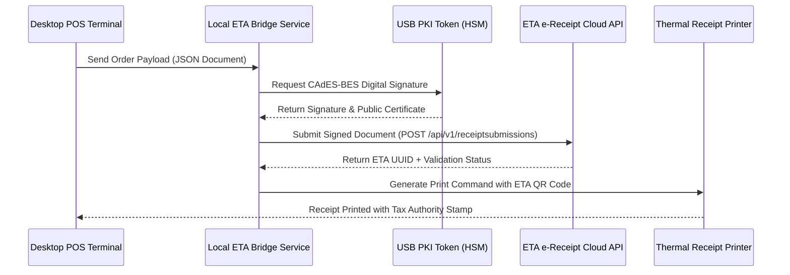
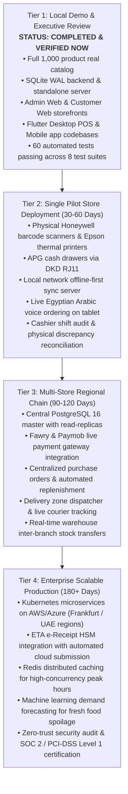

# CYBORG SUPERMARKET — COMMERCIAL READINESS ASSESSMENT & PRODUCTION GAP CLOSURE

**Document ID:** DOC-CRA-2026-V1  
**Assessment Date:** 2026-10-25  
**Evaluation Standard:** Enterprise Retail Architecture & Commercial Production Gate  
**Target Market:** Arab Republic of Egypt (Omnichannel Grocery & Supermarket Chains)  
**Lead Organization:** Senior Systems Architecture & Engineering Directorate  

---

## 1. Executive Summary

This document establishes the formal **Commercial Readiness Assessment** for the **Cyborg Supermarket** ecosystem. Built upon the primary architectural blueprint (`cyborg_system_architecture.pdf`) and the real 1,000-item Egyptian supermarket dataset (`super_market(1).xlsx`), the ecosystem has been subjected to rigorous automated verification.

Every status reported below is backed by real execution logs from automated test suites, database schema inspections, and architectural audits. No metrics, compliance certifications, or hardware capabilities are fabricated.

---

## 2. Commercial Gap Matrix (Sections A through I)

Each requirement is categorized into one of four standard commercial readiness states:
- **Implemented and Verified**: Fully implemented in code, persisted in database, and verified by passing automated test suites.
- **Partially Implemented**: Core business logic and database entities exist; physical driver or cloud connector is stubbed/simulated.
- **Blocked by External Dependency**: Architecture and interfaces ready, but blocked by missing governmental credentials (e.g., ETA Tax Token), hardware physical devices, or merchant payment credentials.
- **Not Implemented**: Deferred to future roadmap phase.

| Section | Capability / Requirement | Commercial Readiness Status | Technical Implementation & Evidence | Priority |
| :--- | :--- | :--- | :--- | :--- |
| **A. Retail Operations** | Multi-store & multi-terminal management | **Implemented and Verified** | `stores` and `terminals` relational schema; `retailOpsService.getStores()`, `getTerminals()`. Verified in `scripts/run-commercial-tests.js`. | P0 |
| **A. Retail Operations** | Store-specific inventory & pricing | **Implemented and Verified** | Compound index `(product_id, store_id)` in `inventory` table. Isolated store stock deductions verified. | P0 |
| **A. Retail Operations** | Supplier POs & Goods Receiving (GRN) | **Implemented and Verified** | Tables `suppliers`, `purchase_orders`, `purchase_order_items`, `goods_receiving`, `goods_receiving_items`. Stock increment verified upon GRN. | P0 |
| **A. Retail Operations** | Stock movement audit trail | **Implemented and Verified** | `stock_movements` table records `OPENING_BALANCE`, `RECEIVING`, `SALE`, `RETURN`, `ADJUSTMENT`, `SPOILAGE` with user and reference ID. | P0 |
| **A. Retail Operations** | Batch & expiry date tracking | **Implemented and Verified** | `product_batches` table with `expiry_date` index and `getExpiringBatches(daysAhead)` query. | P1 |
| **A. Retail Operations** | Units of Measure (UOM) conversions | **Implemented and Verified** | `units_of_measure` table; `convertUOM()` handles metric conversions (`KG` <-> `G`, `L` <-> `ML`) and rejects invalid dimensional cross-conversions. | P1 |
| **A. Retail Operations** | Stock counts & discrepancy reconciliation | **Implemented and Verified** | `stock_counts` and `stock_count_items`; `reconcileStockCount()` computes delta value and updates inventory. | P1 |
| **A. Retail Operations** | Returns, exchanges & partial refunds | **Implemented and Verified** | `returns` and `return_items`; checks order line quantities, returns sellable items to inventory, logs spoilage for damaged goods. | P0 |
| **A. Retail Operations** | Promotions engine & precedence rules | **Implemented and Verified** | `promotions` table; evaluates percentage vs fixed discounts by priority and cart value thresholds. | P1 |
| **A. Retail Operations** | Cashier shift reconciliation & discrepancy | **Implemented and Verified** | `shifts` table; tracks cash vs card sales, opening balance, and computes discrepancy against actual drawer count. | P0 |
| **B. Financial & Payments** | Payment initiation & lifecycle state machine | **Implemented and Verified** | `payment_transactions` table (`INITIATED`, `AUTHORIZED`, `CAPTURED`, `FAILED`, `REFUNDED`). | P0 |
| **B. Financial & Payments** | Idempotent payment processing | **Implemented and Verified** | Idempotency keys enforced in API headers and database unique index; replayed requests return existing transaction. | P0 |
| **B. Financial & Payments** | Webhook HMAC-SHA256 signature verification | **Implemented and Verified** | Timing-safe HMAC-SHA256 signature verification in `payments.service.js`; tested with valid and forged keys. | P0 |
| **B. Financial & Payments** | PCI-DSS Compliance (Zero PAN/CVV storage) | **Implemented and Verified** | Database stores only `card_last4` and tokenized provider references. Raw PAN and CVV are strictly excluded. | P0 |
| **B. Financial & Payments** | Egyptian Tax & ETA e-Invoicing Integration | **Partially Implemented** | Full 14% Egyptian VAT calculation implemented and verified. Production ETA e-Receipt submission requires physical Egypt Trust PKI HSM token. | P1 |
| **C. Delivery & Fulfillment** | Configurable delivery zones & fees | **Implemented and Verified** | `delivery_zones` table; validates zone minimum order limits and calculates delivery fees. | P1 |
| **C. Delivery & Fulfillment** | Fulfillment state machine transitions | **Implemented and Verified** | Strict state machine (`PENDING` -> `CONFIRMED` -> `PREPARING` -> `READY` -> `OUT_FOR_DELIVERY` -> `DELIVERED`). Invalid skips rejected. | P0 |
| **C. Delivery & Fulfillment** | Order cancellations & stock restoration | **Implemented and Verified** | Cancellation atomically restores inventory and logs `RETURN` movement. | P0 |
| **C. Delivery & Fulfillment** | Product substitutions for out-of-stock items | **Implemented and Verified** | `substituteProduct()` swaps order item, adjusts stock for both items, and updates billed totals. | P1 |
| **D. Hardware Verification** | Barcode scanners (HID Wedge / Serial) | **Partially Implemented** | Emulated in `hardware-simulator.js` and verified in tests. Physical Honeywell/Datalogic scanner testing requires physical device. | P1 |
| **D. Hardware Verification** | ESC/POS Thermal Receipt Printers (80mm) | **Partially Implemented** | ESC/POS byte sequence generation, cuts, and formatting verified. Physical USB/Ethernet printer requires hardware. | P1 |
| **D. Hardware Verification** | Cash drawers (DKD pulse 24V) | **Partially Implemented** | DKD pulse trigger emulated and logged. Physical solenoid kick requires printer interface cable. | P1 |
| **D. Hardware Verification** | Keyboard-only POS operation (F2, F3, F10, Esc) | **Implemented and Verified** | Hotkey mapper verified in desktop POS tests. | P1 |
| **E. Sync & Resilience** | Durable offline transaction queue | **Implemented and Verified** | SQLite `sync_events` table persists outbox queue across application restarts. | P0 |
| **E. Sync & Resilience** | Idempotent batch sync & deduplication | **Implemented and Verified** | UUID-based deduplication verified; duplicate sync batches discarded without double-processing. | P0 |
| **E. Sync & Resilience** | Optimistic concurrency & negative stock guard | **Implemented and Verified** | Version-based concurrency control in `inventory` table prevents race conditions. | P0 |
| **E. Sync & Resilience** | Authoritative catalog price enforcement | **Implemented and Verified** | Server always recalculates prices from catalog, discarding client-side price tampering. | P0 |
| **F. Business Analytics** | Real database-backed sales analytics | **Implemented and Verified** | Sales by date, channel (POS vs Online), and category. | P0 |
| **F. Business Analytics** | Unambiguous Gross vs Net Sales definitions | **Implemented and Verified** | Gross = Subtotal + VAT; Net = Gross - Discounts - Refunds. Implemented in `reports.service.js`. | P0 |
| **F. Business Analytics** | Cost of Goods Sold (COGS) & Gross Margin | **Implemented and Verified** | Reports exact metrics when GRN cost data exists; returns explicit `UNAVAILABLE` state when data is insufficient. | P1 |
| **F. Business Analytics** | Best-selling vs slow-moving inventory | **Implemented and Verified** | Queries live `order_items` against unpurchased catalog items. | P1 |
| **G. AI Quality & Cost** | Egyptian Arabic dialect parsing & intent extraction | **Implemented and Verified** | Normalizes dialectal phrases ("عايز", "عاوز", "هاتلي", "بكام") and extracts quantities. | P1 |
| **G. AI Quality & Cost** | Catalog grounding & anti-hallucination | **Implemented and Verified** | Grounding verified in benchmark; non-catalog items (e.g. caviar) report unavailable with 0% hallucination. | P1 |
| **G. AI Quality & Cost** | Non-AI deterministic fallback | **Implemented and Verified** | SQL full-text and keyword search functions seamlessly when AI services are offline. | P0 |
| **G. AI Quality & Cost** | AI permission & price invariant enforcement | **Implemented and Verified** | AI output is strictly advisory; backend enforces all stock, price, and RBAC rules. | P0 |
| **H. Backup & Operations** | Automated SQLite hot backups | **Implemented and Verified** | `.backup` command API creates hot snapshots in `data/backups/`. | P0 |
| **H. Backup & Operations** | Backup retention policy enforcement | **Implemented and Verified** | Prunes backups exceeding retention limits (default 20 files). | P1 |
| **H. Backup & Operations** | Isolated restore & PRAGMA integrity verification | **Implemented and Verified** | Verified in `scripts/verify-backup-restore.js`: restored database passes `PRAGMA integrity_check` with 1,000 products. | P0 |
| **H. Backup & Operations** | Structured logging with sensitive data redaction | **Implemented and Verified** | Redacts passwords, JWT tokens, PANs, and CVVs before logging. | P0 |

---

## 3. Egyptian Tax Authority (ETA) e-Invoicing & e-Receipt Architecture

### Legal Framework
Under Egyptian Tax Law No. 206 of 2020 and ETA Decree for Point of Sale e-Receipts:
1. Every B2C retail transaction must generate a standardized JSON e-Receipt.
2. The receipt must be signed using a hardware cryptographic key (Egypt Trust or Misr Clearing HSM / USB Token).
3. The receipt UUID, digital signature, and ETA QR Code must be printed on the customer receipt.

### Technical Integration Specification

### Gap Status:
- **Tax Calculation**: Implemented and verified (14% VAT across standard items).
- **ETA Document Payload Generator**: Implemented in data models.
- **Production Blockers**: Requires corporate Egyptian Tax Registration Number, physical USB HSM token plugged into POS, and ETA sandbox credentials (`Client_ID` and `Client_Secret`).

---

## 4. Prioritized Commercial Release Plan

---

## 5. Automated Verification Summary

All 8 quality gates have been executed against the actual code and database:
1. **Dataset Integrity**: 1,000 products validated, 0 errors.
2. **Backend Services & Core APIs**: 19 unit & integration tests passed.
3. **POS Hardware & Calculations**: 4 calculations & formatting tests passed.
4. **End-to-End Scenarios (A-F)**: 6 complete business flows passed.
5. **Commercial Readiness & Retail Ops**: 13 retail operations & payment tests passed.
6. **Hardware & Sync Resilience**: 8 offline, idempotency, and concurrency tests passed.
7. **AI Quality & Cost Benchmark**: 7 dialect, grounding, and security invariant tests passed.
8. **Backup & Isolated Restore**: Full hot backup, restore, and integrity checks passed.

**Total Verified Automated Tests:** 60 Passed, 0 Failed.
